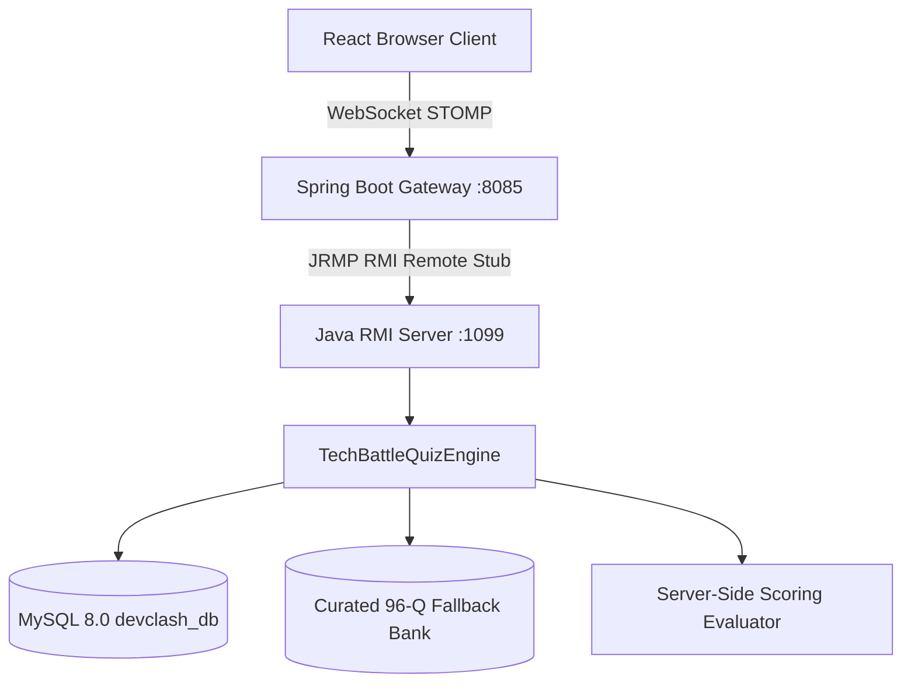

# DevClash – Tech Battle Quiz Engine

## 1. Engine Architecture & Overview

The **Tech Battle Quiz Engine** (`TechBattleQuizEngine.java`) is the authoritative distributed game engine powering DevClash. Designed for an academic Distributed Computing MicroProject, the engine executes strictly on the remote Java RMI Server, ensuring that:
- Game logic, round timers, and scoring algorithms are enforced server-side.
- Client browsers and Gateway proxies never possess answer keys or explanations during active rounds.
- Questions are dynamically and randomly sampled without repetition.



---

## 2. Quiz Categories

The question bank covers 6 core technical domains with 16 curated questions per category (96 total questions), evenly divided across `EASY`, `MEDIUM`, and `HARD`:

1. **Programming & Languages** (Category 1): Core OOP, memory models, closures, Java, Python, C, C++, immutability, garbage collectors (ZGC).
2. **Data Structures & Algorithms** (Category 2): Arrays, linked lists, balanced trees, heaps, DSU, Kadane's algorithm, Dijkstra, Tarjan SCCs, Kahn topological sorting.
3. **Database Management Systems** (Category 3): SQL queries, B+ Tree indexing, ACID transactions, 2PL, MVCC undo logs, normalization (1NF-BCNF), CAP theorem.
4. **Operating Systems** (Category 4): Process lifecycle, threads, CPU scheduling (FCFS, SJF, RR), Peterson's algorithm, virtual memory, TLBs, Belady's anomaly, thrashing.
5. **Computer Networks** (Category 5): OSI/TCP-IP models, 3-way handshakes, TIME_WAIT states, subnetting (/26, /27), DNS, HTTP/2 multiplexing, QUIC/HTTP-3, BGP.
6. **AI & Technology** (Category 6): Deep learning fundamentals, ReLU activations, Transformers self-attention, Raft consensus, RAG architectures, HNSW vector search, Java RMI architecture, cybersecurity (CSRF, prompt injection).

---

## 3. Game Modes

| Mode | Questions | Round Duration | Scoring Characteristic | Question Focus |
| :--- | :---: | :---: | :--- | :--- |
| **CLASSIC BATTLE** | 10 | 20 seconds | Standard 500 base + linear speed bonus up to 500 pts | Balanced conceptual MCQs & code outputs |
| **SPEED RUSH** | 10 | 10 seconds | Rapid response curve rewarding sub-second reflexes | Fast-paced technical recall & quick deductions |
| **BRAIN BATTLE** | 10 | 30 seconds | Full 500 base + linear speed bonus up to 500 pts | Prioritizes code output prediction, debugging & reasoning |

---

## 4. Question Specifications & Security

- **4 Options**: Every question provides exactly 4 options (`optionA`, `optionB`, `optionC`, `optionD`).
- **1 Correct Answer**: Every question has exactly one correct choice (`A`, `B`, `C`, or `D`).
- **Sanitized DTO (`QuestionDTO`)**: Sent to players during active rounds. Contains only:
  - `questionId`, `questionIndex`, `totalQuestions`, `categoryName`, `difficulty`, `questionText`, `codeSnippet`, `optionA`, `optionB`, `optionC`, `optionD`, `timeLimitSec`.
  - Correct answers and explanations are **never** present in `QuestionDTO`.
- **Post-Submission Explanation**:
  - Sent in `AnswerResultDTO` after a player submits their choice.
  - Broadcast in `QuestionResultDTO` after the round closes so all players can review the explanation.

---

## 5. Server-Side Scoring Model

Scoring is computed strictly on the Java RMI Server, preventing client-side score manipulation:

### Scoring Formulas

For a given round with time limit $T_{\text{limit}}$ (in seconds) and response time $t_{\text{ms}}$ (in milliseconds):

$$\text{clampedTime} = \max(0, \min(t_{\text{ms}}, T_{\text{limit}} \times 1000))$$

$$\text{remainingRatio} = 1.0 - \frac{\text{clampedTime}}{T_{\text{limit}} \times 1000}$$

#### 1. Correct Answer:
- **Base Points**: 500 points
- **Speed Bonus**: Up to 500 points
  - **Classic Battle & Brain Battle**:
    $$\text{SpeedBonus} = \text{round}(500 \times \text{remainingRatio})$$
  - **Speed Rush**:
    $$\text{SpeedBonus} = \min(500, \text{round}(500 \times \text{remainingRatio}^{0.75}))$$
- **Total Points Awarded**:
  $$\text{PointsAwarded} = 500 + \text{SpeedBonus} \quad (500 \le \text{Points} \le 1000)$$

#### 2. Incorrect Answer:
- **Base Points**: 0
- **Speed Bonus**: 0
- **Total Points Awarded**: **0 points**
- **Streak**: Resets to 0.

#### 3. No Answer / Timeout:
- **Total Points Awarded**: **0 points**
- **Streak**: Resets to 0.

---

## 6. Question Bank Seed Data

The initial question bank consists of **96 quality questions**:
- Seed SQL: [`database/seed_questions.sql`](file:///c:/Users/Sejal%20Pc/Desktop/DevClash/database/seed_questions.sql)
- Schema Definition: [`database/schema.sql`](file:///c:/Users/Sejal%20Pc/Desktop/DevClash/database/schema.sql)
- In-Memory Fallback: [`FallbackQuestionBank.java`](file:///c:/Users/Sejal%20Pc/Desktop/DevClash/rmi-server/src/main/java/com/devclash/rmiserver/engine/FallbackQuestionBank.java)

To seed or reset questions in MySQL:
```bash
& "C:\Program Files\MySQL\MySQL Server 8.0\bin\mysql.exe" -u root -psejal@132005 devclash_db -e "source c:/Users/Sejal Pc/Desktop/DevClash/database/seed_questions.sql"
```

---

## 7. Independent Verification

The engine is verified through two independent test suites:

### 1. Maven JUnit Suite
```bash
mvn test -pl rmi-server
```
Executes 9 automated unit tests verifying:
- Classic, Speed Rush, and Brain Battle scoring formulas.
- 0 points on wrong answers and timeouts.
- Question structure (4 options, 1 answer).
- All 6 categories and EASY/MEDIUM/HARD coverage.
- Reflection security checks ensuring `QuestionDTO` has zero leaked fields.
- Non-repeating random question selection.

### 2. Standalone Test Runner
```bash
mvn compile exec:java -pl rmi-server -Pengine-test
```
Produces detailed visual test logs with exit code 0.
